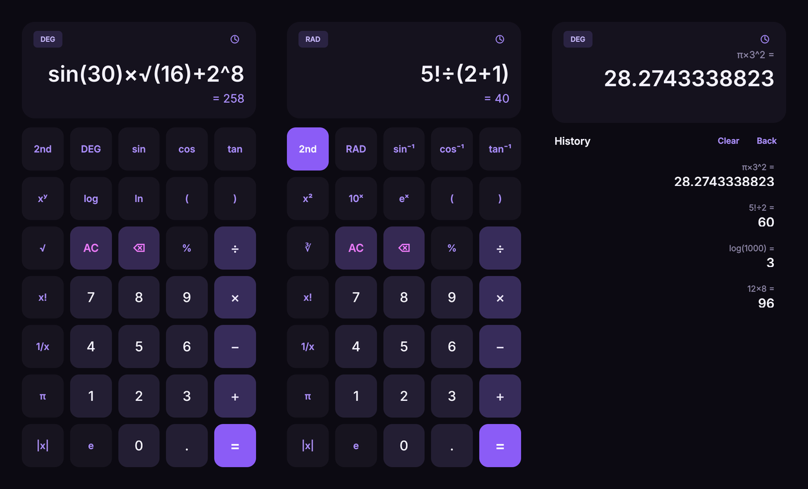
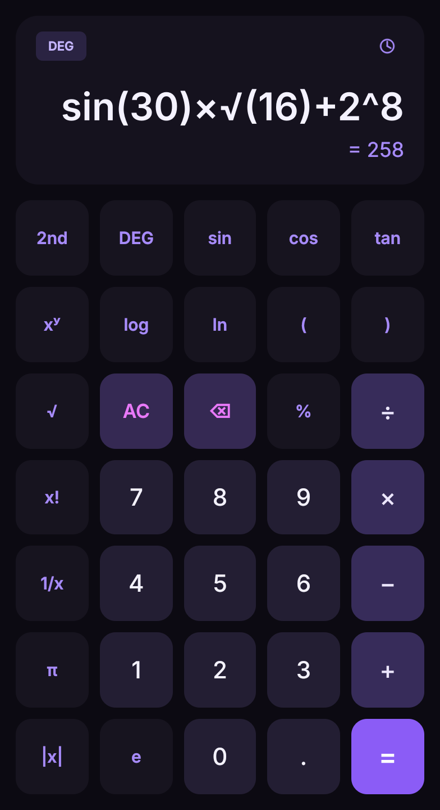
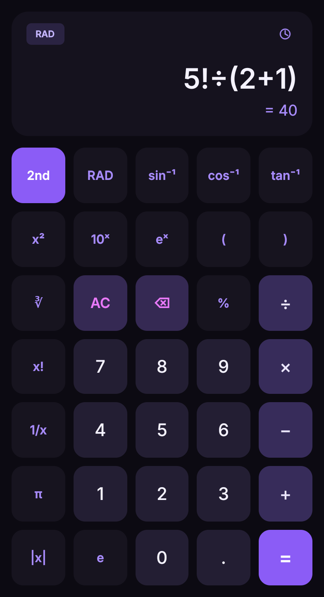
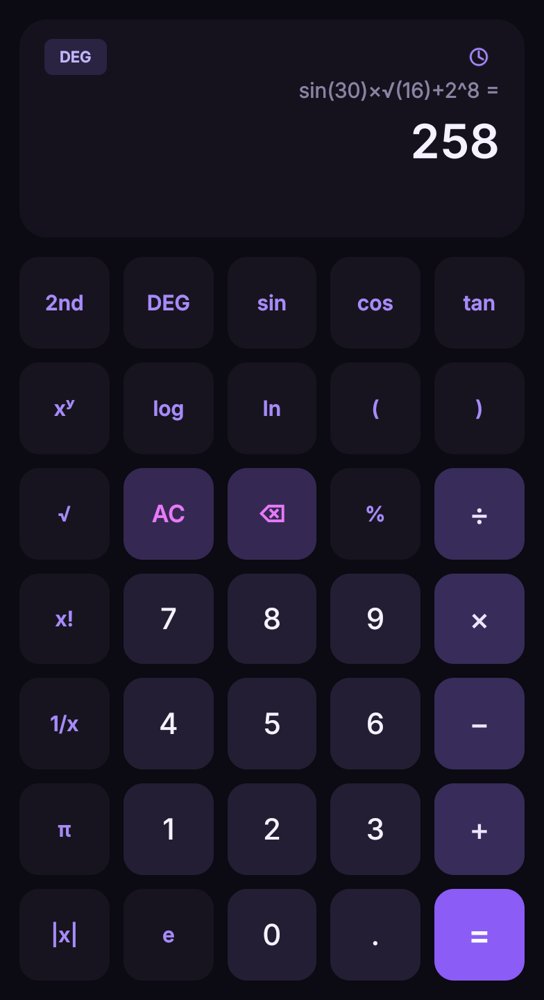
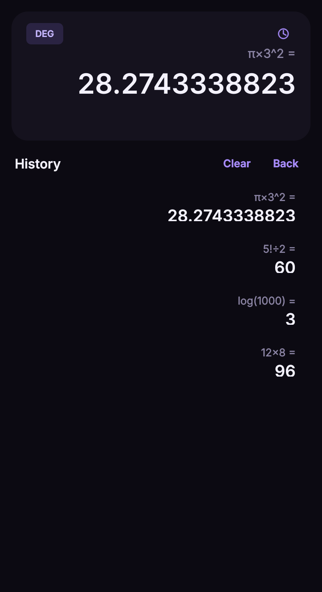

<p align="center">
  
</p>

<h1 align="center">PurpleCalc</h1>

<p align="center">
  A purple, keyboard-friendly <b>scientific calculator for Windows</b> — built with Python &amp; Qt (PySide6).
</p>

<p align="center">
  <a href="https://github.com/muba14/PurpleCalc/actions/workflows/build.yml"></a>
  
  
  
</p>

<p align="center">
  
</p>

## Features

- **Live result** — the answer appears under the expression while you type (`= 258`).
- **Scientific functions** — `sin` `cos` `tan`, `log` `ln`, `√`, `xʸ`, `x!`, `1/x`, `|x|`, `%`, `π`, `e`.
- **2nd mode** — one tap switches to `sin⁻¹` `cos⁻¹` `tan⁻¹`, `x²`, `10ˣ`, `eˣ`, `∛`.
- **DEG / RAD** toggle with a badge on the display.
- **Smart editing** — implicit multiplication (`2π`, `3(4)`), auto-closing parentheses, operator replacement, continue from the last result.
- **History** — the last 100 calculations; click one to reuse it.
- **Full keyboard support** and copy / paste.
- **Safe engine** — a hand-written recursive-descent parser, no `eval()`.
- Dark Windows title bar, custom icon, single portable `.exe`.

## Screenshots

| Calculator | 2nd + RAD | Result | History |
|:--:|:--:|:--:|:--:|
|  |  |  |  |

## Download

Grab **`PurpleCalc.exe`** from the [Releases](https://github.com/muba14/PurpleCalc/releases) page
(or from the latest run's artifacts on the [Actions](https://github.com/muba14/PurpleCalc/actions) tab).
No installation needed — just double-click it.

> Windows SmartScreen may warn because the file isn't code-signed. Click **More info → Run anyway**.

## Keyboard shortcuts

| Key | Action | Key | Action |
|---|---|---|---|
| `0-9` `.` | Numbers | `Enter` / `=` | Calculate |
| `+` `-` `*` `/` `^` | Operators | `Backspace` | Delete last |
| `(` `)` | Parentheses | `Esc` / `Delete` | Clear (AC) |
| `!` `%` | Factorial / percent | `F2` | 2nd mode |
| `s` `c` `t` | sin / cos / tan | `d` | DEG ↔ RAD |
| `l` `n` | log / ln | `Ctrl+C` / `Ctrl+V` | Copy result / paste |
| `r` `a` `i` | √ / \|x\| / 1/x | `Ctrl+H` | History |
| `p` `e` | π / e | | |

## Run from source

```bash
git clone https://github.com/muba14/PurpleCalc.git
cd PurpleCalc
python -m pip install -r requirements.txt
python main.py
```

## Build the .exe yourself

```bash
python -m pip install -r requirements-dev.txt
python -m pytest -q
python -m PyInstaller --noconfirm --clean PurpleCalc.spec
# -> dist/PurpleCalc.exe
```

## Project structure

```
PurpleCalc/
├── main.py                 # entry point
├── purplecalc/
│   ├── engine.py           # tokenizer + parser + number formatting
│   ├── ui.py               # PySide6 window, keypad, history, theme
│   └── fonts/              # Inter (SIL OFL 1.1)
├── tests/                  # engine + headless UI tests (pytest)
├── assets/                 # icon.ico / icon.png, Windows version info
├── PurpleCalc.spec            # PyInstaller recipe
└── .github/workflows/      # Windows build, tests, smoke test, release
```

## Releasing

Push a tag and GitHub Actions builds, tests and attaches `PurpleCalc.exe` to a new release:

```bash
git tag v1.0.0
git push origin v1.0.0
```

## License

MIT © muba14 — the bundled Inter font is licensed under the SIL Open Font License 1.1
(see `purplecalc/fonts/LICENSE-Inter.txt`).
